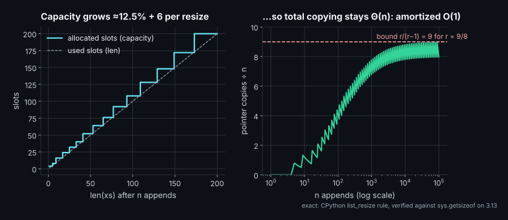
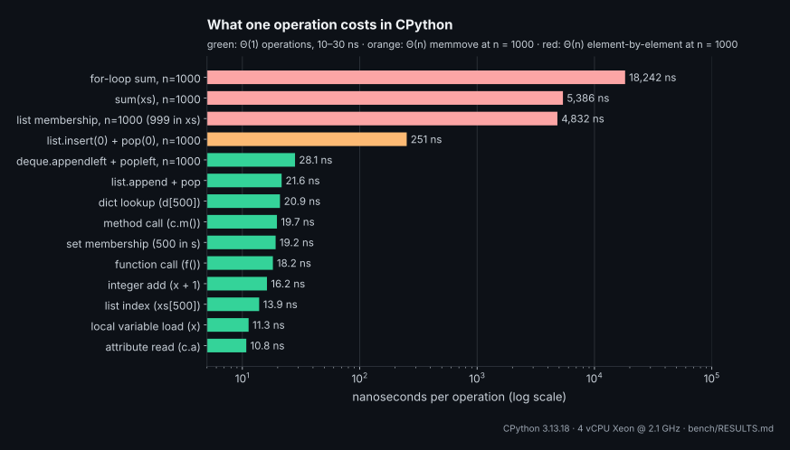
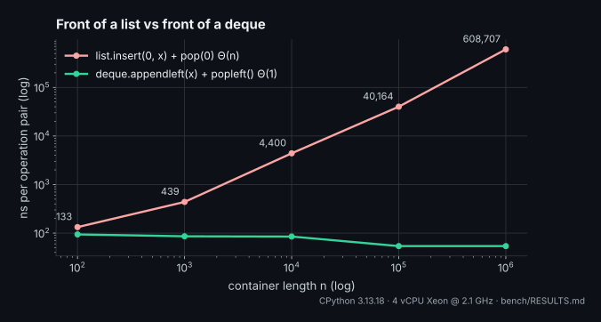

[← Back to Table of Contents](./README.md)

# Chapter 13 — Complexity & Cost Models

> *"Asymptotics tell you which algorithm wins eventually. Constant factors tell you whether 'eventually' arrives before your data does."*

## Overview

Part IV is about choosing algorithms, and that requires two models of cost. The **asymptotic model** ($O$, $\Theta$, $\Omega$) predicts how cost grows with input size and is machine-independent. The **constant-factor model** predicts what one step costs on a real interpreter — and in CPython the gap between a C-implemented builtin and an equivalent Python loop is often larger than the gap between $O(n)$ and $O(n \log n)$ at realistic sizes. This chapter defines both carefully, derives amortized $O(1)$ `list.append` from CPython's actual growth formula, presents a measured cost table that the rest of Part IV relies on, and ends with what to do when a problem is NP-hard and no polynomial algorithm is known. Every built-in cost quoted in the book is collected in [Appendix B](./appendix_b_complexity_reference.md).

<div class="diagram">
<div class="diagram-title">Two cost models, one decision</div>
<div class="compare">
  <div class="compare-side left">
    <div class="compare-title">Asymptotic</div>
    <ul>
      <li>Counts steps as a function of n</li>
      <li>Ignores constants and lower-order terms</li>
      <li>Decides what scales</li>
      <li>Derived on paper</li>
    </ul>
  </div>
  <div class="compare-side right">
    <div class="compare-title">Constant-factor</div>
    <ul>
      <li>Measures ns per operation on a given interpreter</li>
      <li>Dominated by interpreter dispatch in Python</li>
      <li>Decides what is fast at your n</li>
      <li>Measured with <code>timeit</code></li>
    </ul>
  </div>
</div>
</div>

---

## Asymptotic Notation, Precisely

For non-negative functions $f, g$ of input size $n$:

- $f(n) = O(g(n))$ if there exist $c > 0, n_0$ such that $f(n) \le c\,g(n)$ for all $n \ge n_0$ — an **upper bound**.
- $f(n) = \Omega(g(n))$ if $f(n) \ge c\,g(n)$ for all $n \ge n_0$ — a **lower bound**.
- $f(n) = \Theta(g(n))$ if both hold — a **tight bound**.

Two common misuses. First, saying $O$ when $\Theta$ is meant: binary search is $O(n)$ (true, useless) and $\Theta(\log n)$ (informative). This book says $\Theta$ whenever the tight bound is known. Second, conflating **worst-case**, **average-case** and **amortized**: a dict lookup is $\Theta(1)$ average but $\Theta(n)$ worst case (all keys colliding); `list.append` is $\Theta(n)$ worst case for one call but $\Theta(1)$ amortized over a sequence.

<div class="lab" data-lab="growth"></div>

| Growth | Name | $n$ feasible in ~1 s of Python (~$10^7$ simple steps) | Typical source |
|--------|------|:---:|----------------|
| $\Theta(1)$ | constant | any | hash lookup, array index |
| $\Theta(\log n)$ | logarithmic | any | binary search, balanced tree, heap op |
| $\Theta(n)$ | linear | $\sim 10^7$ | one pass |
| $\Theta(n \log n)$ | linearithmic | $\sim 10^6$ | sorting, divide and conquer |
| $\Theta(n^2)$ | quadratic | $\sim 3 \times 10^3$ | all pairs, 2-D DP |
| $\Theta(n^3)$ | cubic | $\sim 200$ | interval DP, Floyd–Warshall |
| $\Theta(2^n)$ | exponential | $\sim 20$–$23$ | subsets, bitmask DP |
| $\Theta(n!)$ | factorial | $\sim 10$ | permutations |

The "feasible $n$" column assumes ~$10^7$ elementary Python operations per second — an *order-of-magnitude estimate*, consistent with the ~20 ns/op measurements below, not a measured limit. For C-speed builtins and NumPy, multiply by 10–100×. [Chapter 23](./23_problem_solving_playbook.md) inverts this table: from the input constraints, infer the complexity the intended solution must have.

---

## Amortized Analysis: Why `list.append` Is O(1)

A Python list is a dynamic array: a contiguous block of pointers with spare capacity ([Chapter 19](./19_data_structure_internals.md)). Appending into spare capacity is one pointer write. When capacity is exhausted, `list_resize` (`Objects/listobject.c`) allocates a bigger block and copies — $\Theta(n)$ for that one call. The question is the cost over a *sequence* of $n$ appends.

CPython's growth rule (3.9+) for a requested size $m$:

$$\text{capacity}(m) = \big(m + \lfloor m/8 \rfloor + 6\big)\ \&\ \sim 3$$

i.e. grow by ~12.5% plus a small constant, rounded down to a multiple of 4. We can observe it directly — `sys.getsizeof` of a list is a 56-byte header plus 8 bytes per *allocated* slot:

```python
import sys

def capacity(lst):
    return (sys.getsizeof(lst) - sys.getsizeof([])) // 8

xs, seen = [], []
for i in range(130):
    before = capacity(xs)
    xs.append(i)
    if capacity(xs) != before:
        seen.append((len(xs), capacity(xs)))
print(seen)
print([(m + (m >> 3) + 6) & ~3 for m, _ in seen])
```

```text
[(1, 4), (5, 8), (9, 16), (17, 24), (25, 32), (33, 40), (41, 52), (53, 64), (65, 76), (77, 92), (93, 108), (109, 128), (129, 148)]
[4, 8, 16, 24, 32, 40, 52, 64, 76, 92, 108, 128, 148]
```

<div class="fig"><div class="figcap">Exact: CPython's growth rule, asserted equal to <code>sys.getsizeof</code> on this interpreter by <code>tools/make_figures.py</code>.</div></div>

Append into a list yourself and watch the spare slots, the resizes, and the running copies-per-append ratio:

<div class="lab" data-lab="append"></div>

The formula reproduces every observed capacity.

**The derivation.** Asymptotically each resize multiplies capacity by $r = 9/8$. A resize at size $s$ copies at most $s$ pointers. The resizes that occur while growing to $n$ happen at sizes $\approx n, n/r, n/r^2, \dots$, so total copying is bounded by the geometric series

$$\sum_{k \ge 0} \frac{n}{r^k} = n \cdot \frac{1}{1 - 1/r} = n \cdot \frac{r}{r-1} = 9n .$$

Total work for $n$ appends is $n$ writes plus at most $\approx 9n$ copies: $\Theta(n)$, so the **amortized** cost per append is $\Theta(1)$ — at most ~10 pointer operations. Numerical check by simulation:

```python
def total_copies(n):
    size = cap = copies = 0
    for _ in range(n):
        if size == cap:
            copies += size                           # realloc copies the current contents
            cap = (size + 1 + ((size + 1) >> 3) + 6) & ~3
        size += 1
    return copies

for n in (10**3, 10**5, 10**6):
    print(n, round(total_copies(n) / n, 2))
```

```text
1000 7.56
100000 7.98
1000000 8.45
```

The ratio stays below the bound of 9 and approaches it as $n$ grows (the $+6$ term makes small lists grow proportionally faster, so they resize less often than the asymptotic ratio predicts). In practice `realloc` can often extend the block in place, so real copying is lower still. Contrast: growing by a **constant** $k$ slots each time costs $\sum n/k \cdot$ (sizes) $= \Theta(n^2/k)$ total — quadratic. **Geometric growth is what makes the amortized bound constant**, whatever the ratio; CPython's small ratio trades a higher amortized constant for less wasted memory (at most 12.5% slack vs 100% for doubling).

The same argument covers `dict` and `set` resizing (dicts keep the load factor at most 2/3, sets below 60% — [Chapter 19](./19_data_structure_internals.md)), `bytearray`, and `str.join` (which precomputes the total size — why `"".join(parts)` is linear while `s += part` in a loop *can* be quadratic; CPython special-cases `s += t` in place when `s` has no other references, but that optimisation is not guaranteed).

---

## The Constant-Factor Cost Model

On CPython every Python-level operation pays instruction dispatch ([Chapter 1](./01_from_source_to_bytecode.md)). From `bench/cost_model.py` (CPython 3.13.18, Linux x86-64, Xeon @ 2.1 GHz, median of 7 runs of 200 000 iterations; ratios are the portable part):

| Operation | ns/op | × local load | Asymptotic |
|-----------|:---:|:---:|:---:|
| **local variable load** | 11.3 | 1.0 | $\Theta(1)$ |
| **attribute read** `c.a` | 10.8 | 1.0 | $\Theta(1)$ avg |
| **list index** `xs[i]` | 13.9 | 1.2 | $\Theta(1)$ |
| **integer add** `x + 1` | 16.2 | 1.4 | $\Theta(1)$ for small ints |
| **function call** `f()` | 18.2 | 1.6 | $\Theta(1)$ |
| **set membership** `v in s` | 19.2 | 1.7 | $\Theta(1)$ avg |
| **method call** `c.m()` | 19.7 | 1.8 | $\Theta(1)$ |
| **dict lookup** `d[k]` | 20.9 | 1.9 | $\Theta(1)$ avg |
| **`append` + `pop()`** | 21.6 | 1.9 | $\Theta(1)$ amortized |
| **`deque.appendleft` + `popleft`** | 28.1 | 2.5 | $\Theta(1)$ |
| **`list.insert(0)` + `pop(0)`**, $n = 1000$ | 251 | 22 | $\Theta(n)$ |
| **list membership**, $n = 1000$, last element | 4 832 | 429 | $\Theta(n)$ |
| **`sum(xs)`**, $n = 1000$ | 5 386 | 478 | $\Theta(n)$ |
| **explicit `for` loop sum**, $n = 1000$ | 18 242 | 1 619 | $\Theta(n)$ |

<div class="fig"><div class="figcap">The same table on a log axis. Generated from <code>bench/cost_model.py</code>.</div></div>

What the table says, quantitatively:

1. **Most single operations cost 10–30 ns** — within 3× of each other. Micro-optimising which $\Theta(1)$ operation you use rarely matters.
2. **An $\Theta(n)$ operation hidden in a loop dominates everything.** `x in some_list` inside a loop over $n$ items is $\Theta(n^2)$; at $n = 1000$ each membership test costs ~250 dict lookups. Converting the list to a set once is the single most common real-world speedup.
3. **Builtins beat loops by ~3.4×** at the same complexity: `sum` runs its loop in C, the `for` loop dispatches ~6 instructions per element. Prefer `sum`, `max`, `any`, `sorted`, `"".join`, `collections.Counter`, `itertools` — and NumPy for numeric arrays, where the factor is 10–100× ([Chapter 22](./22_beyond_python.md)).
4. **`insert(0)` is 10× `deque.appendleft` at $n = 1000$** and the gap grows linearly. Queues use `collections.deque` ([Chapter 18](./18_graph_algorithms.md)'s BFS).

<div class="fig"><div class="figcap">Front insertion as the container grows: Θ(n) vs Θ(1), measured by <code>bench/front_insert.py</code>.</div></div>

### Measuring your own operations

```python
import timeit

setup = "xs = list(range(10_000)); s = set(xs)"
t_list = min(timeit.repeat("9_999 in xs", setup, number=1_000, repeat=5)) / 1_000
t_set = min(timeit.repeat("9_999 in s", setup, number=1_000, repeat=5)) / 1_000
print(f"list/set membership ratio at n=10k: >100x? {t_list / t_set > 100}")
```

```text
list/set membership ratio at n=10k: >100x? True
```

`timeit` disables the garbage collector during timing and runs the statement in a loop; take the `min` (least-disturbed run) for micro-benchmarks and the median for anything with variance you care about. Larger-scale profiling is [Chapter 21](./21_profiling_and_optimization.md).

---

## Space Complexity, Including the Stack

Space has the same notation, and three Python-specific costs:

- **Objects are large.** A list of $n$ small ints is $\approx 36n$ bytes (8-byte pointer + 28-byte int, [Chapter 2](./02_objects_names_and_memory.md)); a 2-D DP table of $10^4 \times 10^4$ Python ints is ~3.6 GB. Rolling arrays ([Chapter 15](./15_dynamic_programming_foundations.md)) or `array`/NumPy are not optional at that size.
- **Recursion uses the call stack.** A recursive algorithm with depth $d$ uses $\Theta(d)$ frames; CPython caps $d$ at `sys.getrecursionlimit()` (1000 by default). Memoized top-down DP has recursion depth equal to the longest dependency chain — often $\Theta(n)$ — which is why bottom-up tabulation is the safer default for large $n$.
- **Memoization caches are unbounded by default.** `functools.cache` stores every distinct argument tuple forever; a DP with $\Theta(n^2)$ states stores $\Theta(n^2)$ entries plus the dict overhead (~100 bytes per entry including key tuples).

---

## When No Efficient Algorithm Is Known: NP-Hardness

Everything above assumes a polynomial algorithm exists. For a large, important class of problems none is known, and most researchers believe none exists. The vocabulary, stated for **decision problems** (yes/no questions):

| Class | Meaning | Example |
|-------|---------|---------|
| **P** | solvable in polynomial time | shortest path, sorting, LCS, 2-coloring |
| **NP** | a "yes" answer has a certificate checkable in polynomial time | "is there a subset summing to $T$?" — check a proposed subset in $\Theta(n)$ |
| **NP-complete** | in NP, and every NP problem reduces to it in polynomial time | SAT, subset sum, graph 3-coloring, Hamiltonian cycle |
| **NP-hard** | at least as hard as NP-complete; need not be in NP | TSP optimisation, longest simple path, optimal bin packing |

The asymmetry between *checking* and *finding* is the whole idea:

```python
import itertools

def verify(nums, subset, target):            # Θ(n): checking a certificate is easy
    return set(subset) <= set(range(len(nums))) and sum(nums[i] for i in subset) == target

def search(nums, target):                    # Θ(2ⁿ · n): no known way to avoid trying subsets in general
    for k in range(len(nums) + 1):
        for subset in itertools.combinations(range(len(nums)), k):
            if sum(nums[i] for i in subset) == target:
                return subset
    return None

nums = [267, 961, 1153, 1000, 1922, 493, 1598, 869, 1766, 1246]
cert = search(nums, 5842)
print(cert, verify(nums, cert, 5842), 2 ** len(nums), "subsets in the worst case")
```

```text
(1, 3, 7, 8, 9) True 1024 subsets in the worst case
```

**Recognising NP-hardness saves time:** if a problem is "choose a subset / an order / an assignment that optimises something under combinatorial constraints", look it up before designing an algorithm. Then pick a strategy:

| Situation | Strategy | Chapter |
|-----------|----------|:---:|
| **$n \le 20$–$25$** | exact exponential search: bitmask DP (Held–Karp $\Theta(2^n n^2)$), backtracking with pruning | [14](./14_recursion_and_divide_and_conquer.md), [16](./16_dynamic_programming_patterns.md) |
| **Numbers are small** (weights, capacities) | pseudo-polynomial DP — knapsack and subset sum are only *weakly* NP-hard | [15](./15_dynamic_programming_foundations.md), [20](./20_bit_manipulation.md) |
| **Good is enough, with a guarantee** | approximation: greedy set cover within $\ln n$ of optimal; Christofides within 1.5× for metric TSP | [17](./17_greedy_algorithms.md) |
| **Good is enough, no guarantee needed** | heuristics: local search, simulated annealing, beam search | [16](./16_dynamic_programming_patterns.md) |
| **Real instance, real constraints** | hand it to a solver: ILP (OR-Tools, HiGHS via PuLP/Pyomo), CP-SAT, SAT (PySAT) | — |

Industrial solvers routinely handle NP-hard instances with thousands of variables, because real instances have structure that worst-case bounds ignore. Writing your own branch-and-bound is rarely the right first move.

---

## Choosing by Both Models

<div class="diagram">
<div class="diagram-title">Order of operations when code is too slow</div>
<div class="flow">
  <div class="flow-node accent wide">1. Is the complexity right for n? <small>Θ(n²) at n=10⁶ cannot be saved by constants</small></div>
  <div class="flow-arrow"></div>
  <div class="flow-node purple wide">2. Is there a hidden Θ(n) inside a loop? <small>list membership, insert(0), slicing copies, str +=</small></div>
  <div class="flow-arrow"></div>
  <div class="flow-node green wide">3. Can the loop move into a builtin or C library? <small>sum, sorted, Counter, itertools, NumPy</small></div>
  <div class="flow-arrow"></div>
  <div class="flow-node orange wide">4. Only then: micro-optimise, cache, or leave Python <small>Ch 21, Ch 22</small></div>
</div>
</div>

---

## Key Takeaways

- $O$ is an upper bound, $\Omega$ a lower bound, $\Theta$ tight; worst-case, average-case and amortized are different claims and must be stated.
- CPython grows lists by ~12.5% plus a constant; geometric growth bounds total copying by $n \cdot r/(r-1) \approx 9n$, so `append` is $\Theta(1)$ amortized — verified by simulation.
- Constant growth increments would make $n$ appends $\Theta(n^2)$; geometric growth of any ratio keeps them linear.
- Single CPython operations cost ~10–30 ns and differ by under 3×; a $\Theta(n)$ operation hidden in a loop is the usual cause of slowness.
- C-implemented builtins beat equivalent Python loops by ~3× at the same complexity; NumPy by far more.
- Space costs in Python include large object headers, recursion depth capped at 1000 frames, and unbounded memoization caches.
- NP-hard problems have no known polynomial algorithm; recognise them early and choose exact-exponential search for small $n$, pseudo-polynomial DP for small numbers, approximation or heuristics for good-enough answers, or an ILP/SAT solver.

## References

| Source | Author / Org, Year | Link | What this chapter takes from it |
|--------|--------------------|------|--------------------------------|
| *Introduction to Algorithms*, 4th ed., ch. 3 and 16 | Cormen, Leiserson, Rivest, Stein, 2022 | MIT Press | Asymptotic notation; amortized analysis (aggregate method, dynamic tables) |
| `Objects/listobject.c` — `list_resize` | CPython | github.com/python/cpython | The over-allocation formula |
| TimeComplexity | Python Wiki | wiki.python.org/moin/TimeComplexity | Average/worst costs of built-in operations |
| `timeit` docs | Python docs | docs.python.org/3/library/timeit.html | Measurement methodology |
| *Computers and Intractability* | Garey, Johnson, 1979 | W. H. Freeman | NP-completeness, reductions, weak vs strong NP-hardness |
| `bench/front_insert.py` | this repo | [bench/RESULTS.md](./bench/RESULTS.md) | Front-insertion scaling |
| `bench/cost_model.py` | this repo | [bench/RESULTS.md](./bench/RESULTS.md) | Measured constant-factor table |

---

**Next:** [Chapter 14 — Recursion & Divide and Conquer](./14_recursion_and_divide_and_conquer.md) — solving a problem by solving smaller copies of it.
